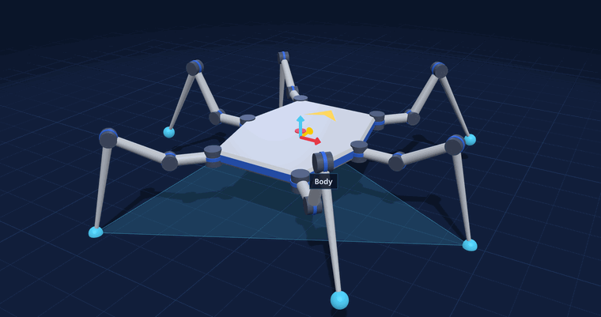
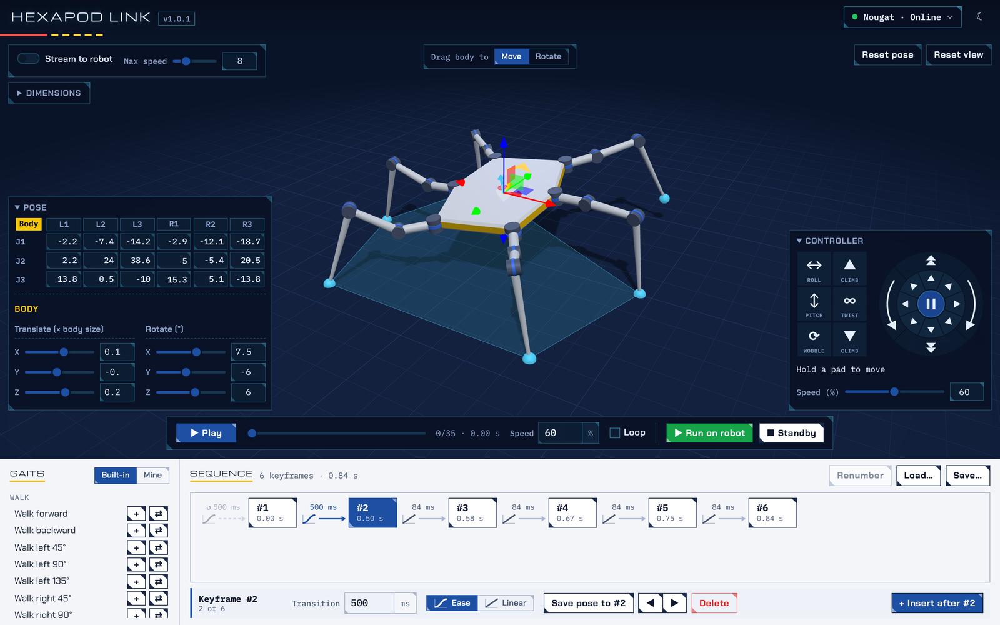
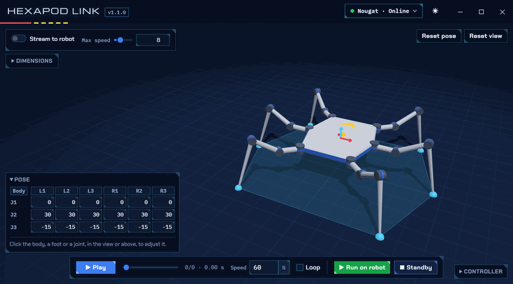
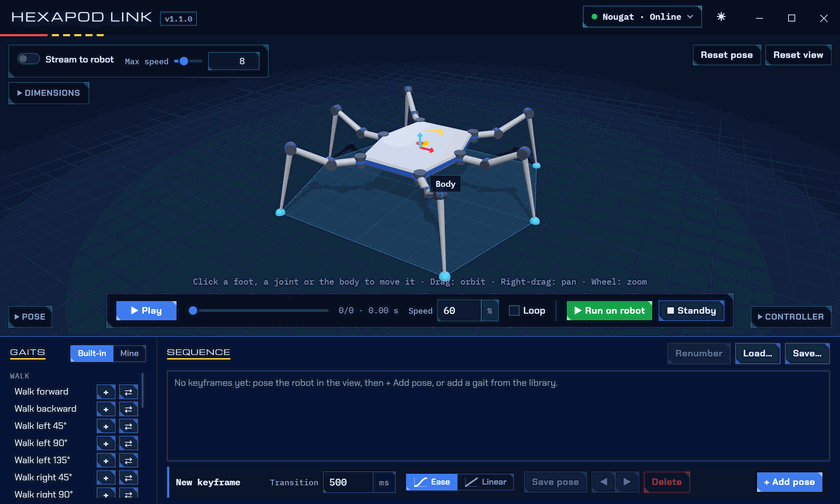
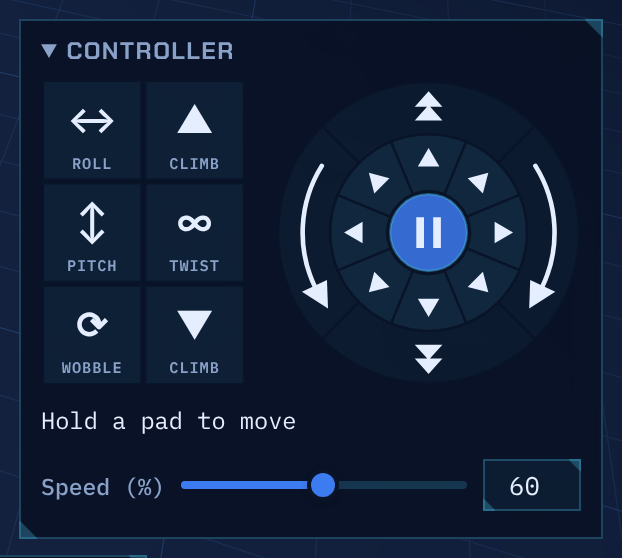

[](https://github.com/rookidroid/hexapod-link/actions/workflows/tests.yml)
[](https://github.com/rookidroid/hexapod-link/actions/workflows/build-desktop.yml)
[](./LICENSE)

# Hexapod Link


Pose, animate and drive a six-legged robot from your computer. 🕷️

Hexapod Link shows your [rookidroid](https://rookidroid.com/) hexapod robot in
3D on your screen. You can:

- move the robot's body and feet with your mouse,
- put moves together into a short dance or walk,
- and play it on the real robot over WiFi.

**No robot yet?** No problem. Everything works without one, except sending
moves to the real robot.

<p align="center">
  
</p>

## What you can do

- **Pose it.** Click the robot's body or one of its feet, then drag it where
  you want. The app works out how every joint has to bend. If a leg can't
  reach any further, it stops there.
- **Animate it.** Line up your own poses and the robot's ready-made moves
  (walk, turn, climb, twist and more), choose how long each takes, and watch
  them play.
- **Drive it.** Hold a button on the on-screen controller and the robot walks
  or turns. Let go and it stops.
- **Run it on the real robot.** Connect over WiFi and the robot copies what
  you see on screen.
- **Use any robot in the family.** Nougat, Mochi, Macaroon and the others all
  work. Your robot tells the app its size when it connects, so the 3D model
  always matches it.

## A quick tour of the window

<picture><source media="(prefers-color-scheme: dark)" srcset="docs/images/app-dark.png"></picture>

Everything is on one screen:

| Where | What it does |
|---|---|
| **Top bar** | Shows whether a robot is connected. Click it to connect. The ☾ / ☀ button switches between dark and light colours. |
| **3D view** (the middle) | Shows the robot. Drag with the left mouse button to look around it, drag with the right button to slide the view, and use the scroll wheel to zoom. A short reminder of this sits at the bottom of the view. |
| **Stream to robot** and **Dimensions** (top left) | Make the real robot follow the screen as you pose it. See or change the robot's measurements. |
| **Pose** (bottom left) | Every joint's angle, plus the controls for the part you have clicked. |
| **Controller** (bottom right) | Buttons that drive the robot around. |
| **Playback bar** (bottom middle) | Play your animation, slow it down or speed it up, repeat it, or run it on the robot. |
| **Gaits** and **Sequence** (the panel along the bottom) | Build your animation. |

**Pose**, **Dimensions** and **Controller** can be folded away. Click a
panel's title to open or close it.

## Get started

### Step 1: Install the app

**The easy way: download it.** No other software needed.

1. Go to the [latest release](https://github.com/rookidroid/hexapod-link/releases/latest).
2. Under **Assets**, download the file for your computer:
   - Windows: `HexapodLink-…-windows-x64-setup.exe`. Double-click it and
     follow the steps. It adds **Hexapod Link** to the Start menu and the
     desktop, and you can uninstall it from **Settings → Apps**.
   - Linux: `HexapodLink-…-linux-x64.AppImage`. Make it runnable
     (right-click → **Properties → Allow executing as program**, or
     `chmod +x` it), then double-click it. On Debian or Ubuntu you can
     instead install `HexapodLink-…-linux-x64.deb` with
     `sudo apt install ./HexapodLink-…-linux-x64.deb`.
3. Rather not install anything? Download the `-portable` `.zip` (Windows) or
   `.tar.gz` (Linux) instead, unpack it, and double-click **HexapodLink**
   (`HexapodLink.exe` on Windows) in the `HexapodLink` folder.

Your saved poses and gaits are kept in your home folder, so updating or
uninstalling the app keeps them.

The window opens with a robot standing ready. Windows may warn you that the
app (or its installer) comes from an unknown publisher. If it does, click **More info**, then
**Run anyway**.

<details>
<summary>Prefer to run it from the source code?</summary>

You need [Node.js](https://nodejs.org/) 22 or newer.

1. Get the code: at the top of this page, click **Code → Download ZIP**, then
   unzip it.
2. Open a terminal in the unzipped folder. On Windows, open the folder in
   File Explorer, type `cmd` in the address bar, and press Enter.
3. Install what the app needs. You only do this once:

   ```bash
   npm install
   ```

4. Start the app:

   ```bash
   npm start
   ```

Next time, step 4 is all you need.

</details>

### Step 2: Connect your robot

Just want to try the app? Skip this step. Everything on screen works without
a robot.

1. Switch the robot on.
2. On your computer, **join the robot's WiFi network**. The robot makes its
   own network, so you won't have internet while you're on it. That's normal.
   The robot stands up when your computer joins.
3. In the app, click **Offline** in the top bar, then click **Connect**. The
   address is already filled in for you (`192.168.4.1`).

The light in the top bar turns green and shows your robot's name. The 3D
model changes to match your robot.

> [!NOTE]
> Your robot needs up-to-date firmware (the software that runs on the robot
> itself). You can find it in
> [rookidroid/hexapod](https://github.com/rookidroid/hexapod), in the
> `software/hexapod_esp32` folder. If **Connect** ends in **Fault** even
> though you are on the robot's WiFi, update the firmware.

### Step 3: Stay safe

> [!WARNING]
> **Put the robot on a stand before you send it anything.** A pose that looks
> fine on screen might tip the robot over on the floor, and legs can move
> faster than you expect.

The app helps keep things safe:

- It never moves a joint further than your robot allows.
- If the WiFi connection drops, the robot stands back up by itself after
  about a second.

One thing to watch: an animation always starts by moving to its first pose,
wherever the robot happens to be. That first move can be quick. Make your
first pose close to standing, or click **Standby** before **Run on robot**.

## Pose the robot

<p align="center">
  
</p>

1. **Pick a part.** Click the body, a foot or a joint in the 3D view. You can
   also use the buttons in the **Pose** panel: **Body**, or **L1** to **R3**
   for the legs (L for left, R for right, numbered front to back). To let go,
   click empty space, or click the same button again.
2. **Move the body.** With the body picked, drag its coloured arrows to slide
   it. To tilt or turn it instead, switch **Drag body to** from **Move** to
   **Rotate** (at the top of the view), then drag the rings. The feet stay
   where they are and the legs bend to follow. The sliders in the **Pose**
   panel do the same thing.
3. **Move a foot.** With a foot picked, drag its arrows. Or type where it
   should go: **X**, **Y**, and **Up** (its height off the floor), all in
   millimetres. **Put feet back** returns every foot to where it started.
4. **Turn a joint.** With a joint picked, drag the ring around it. Only that
   joint turns; the rest of the leg moves along with it. It stops at the
   joint's limit.
5. **Start over.** **Reset pose** (top right) puts the robot back to
   standing. **Reset view** puts the camera back.

Good to know:

- Moving the body and moving a foot don't cancel each other out. Tilt the
  body, lift a foot, and both stay.
- If you drag something further than a leg can reach, it stops at the edge.
- You can also type a joint angle straight into the table.

**Want the real robot to copy you as you pose?** Turn on **Stream to robot**
at the top left. **Max speed** next to it limits how fast the robot's motors
may move.

## Make an animation

<p align="center">
  <picture><source media="(prefers-color-scheme: dark)" srcset="docs/images/sequence-dark.gif"></picture>
</p>

An animation is called a **sequence**. It is a row of **keyframes**: poses
the robot moves through, one after another. Each keyframe also has a time:
how long the robot takes to get to it.

The robot's ready-made moves are called **gaits** (a gait is a way of
walking, like a walk or a turn).

1. **Add a gait.** In **Gaits**, click **+** next to one to add it to your
   sequence. Click **+** again to add it once more; the copies join up
   smoothly. **⇄** replaces your whole sequence with that gait instead.
2. **Add your own pose.** Pose the robot, then click **+ Add pose**. If a
   keyframe in the middle is selected, the button says **+ Insert after #2**
   (or whichever one it is), and the new pose goes right after it.
3. **Change a keyframe.** Click it in the row. The bar underneath lets you
   change it:
   - **Transition**: how long the move into this keyframe takes, in
     milliseconds (1000 ms = 1 second).
   - **Ease** or **Linear**: Ease starts and stops gently; Linear moves at a
     steady speed.
   - **Save pose**: replaces the keyframe with the pose on screen.
   - **◀ ▶**: move the keyframe earlier or later.
   - **Delete**: removes it.

   Keyframes keep their number when you move them around. **Renumber** puts
   them back in order as 1, 2, 3…
4. **Watch it.** Click **Play**, or drag the slider next to it. **Speed**
   plays everything slower or faster, and **Loop** repeats it. When looping,
   the move from the last keyframe back to the first uses the first
   keyframe's time; that's the **↺** arrow in front of it (dimmed when Loop
   is off).
5. **Run it on the robot.** Click **Run on robot**. **Standby** stops it and
   makes the robot stand.

Tips:

- Pause playback anywhere and that moment becomes the pose on screen. Change
  it, then click **+ Add pose at …** to add a new keyframe right there.
- A foot moves in a straight line from one keyframe to the next. To step
  *over* something, add a keyframe in between with the foot lifted.
- **Save…** and **Load…** keep a sequence as a file on your computer. A file
  only opens for the robot model it was made on.
- To keep a sequence as your own gait, switch **Gaits** to **Mine**, give it
  a name and click **Save sequence**. It stays in the list from then on, with
  the same **+** and **⇄** buttons as the built-in gaits.

## Drive with the controller



Click **Controller** at the bottom right of the view to open it. It looks
like the control screen of the
[Android app](https://play.google.com/store/apps/details?id=com.rookiedev.hexapod).

- **The circle** makes the robot walk. The eight arrows around the middle are
  the directions. The outer buttons are fast forward, fast backward, and
  turning left or right. The middle button makes the robot stand still.
- **The six buttons on the left** move the robot in place: roll, pitch,
  wobble, twist, and climb forward or back.
- **Speed** sets how fast it goes.

Hold a button and the robot moves. Slide your finger or mouse onto another
button to change move. Let go and it stands still. These are moves built into
the robot, so they stay smooth even when the WiFi signal is weak.

The controller only works when a robot is connected. Until then it is greyed
out.

## Tips

- The app remembers your colour theme, panel sizes, which panels are folded,
  your last robot, and your last pose and sequence. It opens just the way you
  left it.
- Drag the top edge of the bottom panel to make it taller or shorter. Drag
  the lines between its columns to make them wider or narrower.
  Double-click an edge to put it back.
- Under **Dimensions** you can change the size of the body and legs to try
  out a different robot design. They go back to your robot's real size when
  it connects.
- If a leg on the real robot points slightly differently from the screen,
  adjust it on the robot's own calibration page, not in this app.

## Something not working?

| What you see | What to try |
|---|---|
| **Connect** ends in **Fault** | Make sure your computer is on the robot's WiFi, not your home WiFi, and that the robot is switched on. Hover over the status light to see why it failed. |
| Some buttons are greyed out | They need a connected robot. **Stream to robot**, **Run on robot** and the **Controller** turn on once a robot is connected. |
| A leg won't go where you drag it | It is already reaching as far as it can, or a joint is at its limit. The **Pose** panel tells you which leg. |
| A sequence file won't load | It was made for a different robot model. |
| The real robot's legs are a little off from the screen | Adjust them on the robot's own calibration page. |
| The window is blank or doesn't open | Use the app in your web browser instead. See [Step 1](#step-1-install-the-app). |

## For developers

Running from the source code, changing the look, building the desktop app,
running the tests, regenerating the pictures on this page, and how the app
talks to the robot are all covered in [docs/DEVELOPMENT.md](docs/DEVELOPMENT.md).

## Credits

Hexapod Link started as a fork of
[mithi/hexapod-robot-simulator](https://github.com/mithi/hexapod-robot-simulator).
Its [Wiki](https://github.com/mithi/hexapod-robot-simulator/wiki/Notes)
explains the maths behind it.

Original project: [@mithi](https://github.com/mithi/),
[@philippeitis](https://github.com/philippeitis/),
[@mikong](https://github.com/mikong/), [@guilyx](https://github.com/guilyx),
[@markkulube](https://github.com/markkulube)

This fork ([rookidroid/hexapod-link](https://github.com/rookidroid/hexapod-link)):
[@rookidroid](https://github.com/rookidroid/)

## License

MIT. See [`LICENSE`](./LICENSE). Copyright (c) 2020 Mithi Sevilla, (c) 2026 rookidroid.com.


